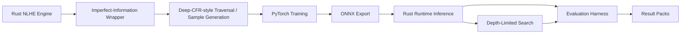

# Talibus

**Research prototype for 6-max No-Limit Texas Hold'em AI systems and
imperfect-information game evaluation.**

[](https://github.com/Taliwanmli/Talibus-Deep-CFR-Poker-AI/actions/workflows/python-ci.yml)
[](https://github.com/Taliwanmli/Talibus-Deep-CFR-Poker-AI/actions/workflows/rust-ci.yml)

Talibus explores how to build an imperfect-information game AI system around a
Rust poker simulation/runtime stack, a Deep-CFR-style training pipeline,
PyTorch models, ONNX deployment, scripted opponent evaluation, and
depth-limited search.

It is intended as a systems and AI research project around poker-like decision
problems, not as a real-money poker bot, live-play assistant, overlay, casino
automation tool, or platform-rule bypass tool. It does not claim solved poker,
superhuman play, production readiness, real-world profitability, or proven
multiplayer Deep CFR convergence.

## Run The Pipeline

With Rust stable, a native build toolchain, and the [Python requirements
installed](docs/setup.md#python-environment), run from the repository root:

```bash
python training/deep_cfr/run_smoke.py
```

This CPU-only check builds the required Rust binaries, generates real traversal
samples, trains fresh PyTorch advantage and strategy networks, exports ONNX,
and evaluates the new strategy model through Rust inference. It prints the run
directory, completed manifest, and structured result. No CUDA or historical
training buffers are needed.

See [CPU Smoke Experiment](docs/smoke.md) for outputs, observed runtime/disk use,
and reproducibility limits. The tiny run verifies pipeline health; it does not
measure poker strength.

## Plain-English Summary

Poker is an imperfect-information game: the agent must make decisions while
hidden information remains unresolved, including opponents' private cards and
future actions. Talibus explores how an engine, training pipeline, model
deployment path, search layer, and evaluation harness can be built around that
kind of decision problem.

## Status

The repository includes a real CPU end-to-end verification path, experiment
configuration and provenance tooling, Python/Rust tests and CI, documentation,
compact controlled simulator results, and trained ONNX model artefacts. Large
generated buffers, raw logs, and PyTorch checkpoints are excluded from Git.

The small smoke pipeline can run from a development checkout after setup. Full
historical long-run reproduction still requires generated training data,
configured dependencies, and substantial compute.

## Trained Model Release

The public model release is:

`artifacts/models/talibus-6max-longrun-opt-v1/`

It contains:

- `strategy_shared_best_ring.onnx`: the default released strategy model used
  for the published mixed-table evaluation.
- `advantage_shared_best_ring.onnx`: the paired advantage model from the same
  best-ring promotion snapshot.
- `model_spec.json`: machine-readable model, abstraction, training, ONNX, and
  evaluation metadata.
- `SHA256SUMS`: checksums for the ONNX artefacts.

The trained model should be interpreted as research-prototype evidence and
reproducibility support, not as a production poker bot or claim of real-world
poker strength.

## Published Controlled Benchmark

The released strategy model is tied to the compact result pack at
`results/2026-04-03-6max-longrun-opt/`.

In that controlled simulator benchmark, Talibus was evaluated across all six
seats in 1,000-hand mixed-table runs with a 2,000 ms depth-limited-search
budget, 200 deck samples, and scripted opponents in the order TAG, calling
station, LAG, nit, TAG. Within that setup, the seat results ranged from
3664.615 to 6222.160 bb/100, averaging 5008.903 bb/100.

These measurements apply to that scripted simulator setting. The result pack
does not include confidence intervals and does not establish real-money
profitability, human-level strength, commercial solver quality, or superhuman
play. See [Evaluation](docs/evaluation.md) for the per-seat results and limits.

## Highlights

- Rust NLHE game mechanics, betting, pots, showdown, and legal-action handling.
- Imperfect-information wrappers and fixed action-slot abstraction.
- Deep-CFR-style traversal and sample generation.
- Reservoir and disk-backed training buffers.
- Scripted TAG, LAG, nit, and calling-station baseline policies.
- Model-only ring-game evaluation.
- Depth-limited search experiments over a neural policy.
- Evaluation harnesses for seat rotation, checkpoint progression, opponent
  comparison, mixed tables, and search-budget sweeps.
- Compact public result packs under `results/`.

## Architecture At A Glance



## Documentation

- [Architecture](docs/architecture.md): component map and runtime/training flow.
- [Project Walkthrough](docs/project-walkthrough.md): reader-friendly overview
  of the system, evaluation framing, reproducibility boundaries, and
  responsible-use context.
- [Setup](docs/setup.md): installation, checks, and common commands.
- [CPU Smoke Experiment](docs/smoke.md): the end-to-end verification command,
  output artifacts, provenance, and determinism boundaries.
- [Model Release](docs/model_release.md): released ONNX artefacts, tensor
  shapes, hashes, usage commands, and metric interpretation.
- [Evaluation](docs/evaluation.md): evaluation harnesses and published result
  pack interpretation.
- [Limitations](docs/limitations.md): scope, caveats, and claims this project
  does not make.
- [Responsible Use](docs/responsible-use.md): intended and prohibited uses.
- [v0.1 Release Notes](docs/release-notes-v0.1.md): public release summary for
  the first research snapshot.
- [v0.2 Release Notes](docs/release-notes-v0.2.md): merged reproducibility
  milestone, verification evidence, and limitations.
- [Roadmap](ROADMAP.md): conservative next steps.

## Repository Layout

```text
checkpoints/nlhe_clusters/     Precomputed abstraction cluster assets
docs/                          Architecture, setup, evaluation, limitations, and release notes
eval/                          Python evaluation helpers and regression tests
results/                       Compact public result packs
solver/                        Rust workspace for game, CFR, and runtime code
training/deep_cfr/             PyTorch training and long-run orchestration
training/deep_cfr/experiments/  Portable experiment configurations
training/deep_cfr/run_smoke.py  CPU end-to-end verification command
run_eval_suite.py              Structured 6-max evaluation runner
deep_cfr_watchdog.ps1          Windows helper for long training runs
```

Large generated buffers, raw logs, PyTorch checkpoints, and ONNX model binaries
outside the published model package are not committed directly to Git. The
included result pack records model metadata and SHA-256 hashes for the
artefacts used to produce the published evaluation.

## Quick Start

Install Rust stable, Python 3.10 or newer, and a native build toolchain. Then:

```bash
python3 -m venv .venv
source .venv/bin/activate
pip install --upgrade pip
pip install -r training/deep_cfr/requirements.txt
pip install -r eval/requirements.txt
```

On Windows PowerShell:

```powershell
py -3 -m venv .venv
.\.venv\Scripts\Activate.ps1
python -m pip install --upgrade pip
python -m pip install -r training\deep_cfr\requirements.txt
python -m pip install -r eval\requirements.txt
```

Build and test the Rust workspace:

```bash
cargo check --manifest-path solver/Cargo.toml --workspace --locked
cargo test --manifest-path solver/Cargo.toml --workspace --locked
cargo build --manifest-path solver/Cargo.toml --release --locked -p deep_cfr --bin ring_game_eval --bin realtime_play
```

Run Python checks from the repository root:

```bash
python -m compileall -q training/deep_cfr eval run_eval_suite.py
python -m unittest discover eval
python -m unittest discover -s training/deep_cfr -p "test_*.py"
python run_eval_suite.py --help
```

See `docs/setup.md` for platform notes, ONNX Runtime details, and the longer
verification checklist.

## Quick Verification

After [setup](docs/setup.md), run `python training/deep_cfr/run_smoke.py`.
The checked-in [CPU profile](training/deep_cfr/experiments/cpu_smoke.json)
drives traversal, training, ONNX export, and a 12-hand Rust model-only
evaluation. Each invocation creates a fresh directory under
`data/experiments/cpu-smoke/` and records settings, seeds, stage exit codes,
runtime facts, and artifact SHA-256 hashes in `manifest.json`.

[CPU Smoke Experiment](docs/smoke.md) explains how to inspect a completed run.
[Setup](docs/setup.md#source-and-test-checks) lists the faster source/unit checks;
[Model Release](docs/model_release.md#running-the-released-strategy-model)
contains separate commands for the historical released model.

## Training

The main training entry point is:

```bash
python training/deep_cfr/run_deep_cfr.py --help
```

A full 6-max run requires the Rust traversal binary, abstraction clusters, and
substantial generated data under `data/`. Start with small smoke settings before
launching long runs. Long-run artifacts can be many gigabytes and are excluded
by `.gitignore`.

## Evaluation

The main structured evaluation entry point is:

```bash
python run_eval_suite.py --help
```

The suite expects compiled Rust binaries and a trained ONNX strategy model.
Evaluation outputs are controlled simulator measurements against scripted
baselines. They are useful for regression testing and research comparison, but
they are not evidence of real-money performance, human-level strength, or
solver-level strength.

The [historical result pack](results/2026-04-03-6max-longrun-opt/README.md)
contains the mixed-table measurements summarized above, model hashes, and
recorded settings. See [Evaluation](docs/evaluation.md) for result-file meanings
and the limits of historical reproduction.

## Additional Notes

`training/deep_cfr/REMOTE_WINDOWS_RUNBOOK.md` contains a generalized remote
Windows training workflow for larger experiments.

## License

This project is released under the MIT License. See `LICENSE`.
